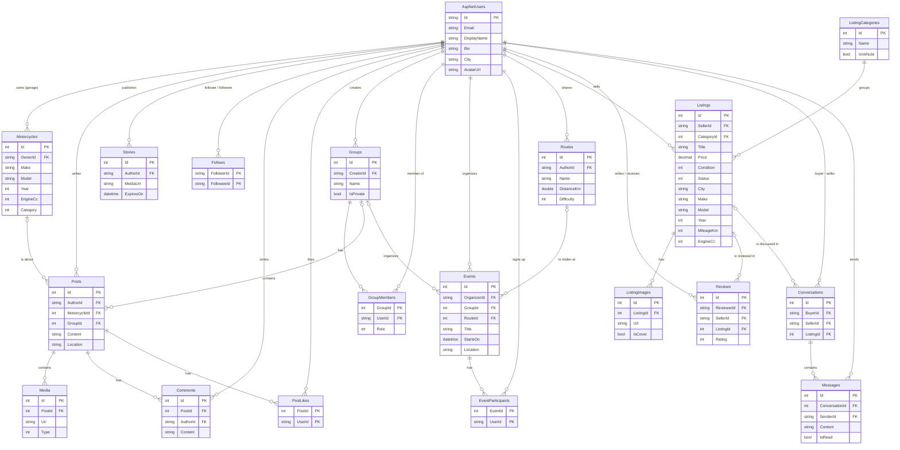

# База данни на MotoGrid

Базата данни е MS SQL Server. Схемата се създава от EF Core миграциите в
`src/MotoGrid.Data/Migrations`. Генерираният SQL скрипт е в [`schema.sql`](schema.sql).

Освен таблиците по-долу има и стандартните таблици на ASP.NET Core Identity
(`AspNetRoles`, `AspNetUserRoles`, `AspNetUserClaims` и др.).

## ER диаграма

## Основни решения

- **Soft delete** – записите не се изтриват физически (`IsDeleted`, `DeletedOn`).
- **Одит** – `CreatedOn` и `ModifiedOn` се попълват автоматично в `ApplicationDbContext`.
- **Без каскадно изтриване от потребителите** – връзките към `AspNetUsers` са `NO ACTION`,
  което предотвратява грешката на SQL Server за няколко каскадни пътя.
- **Съставни ключове** за свързващите таблици (`PostLikes`, `Follows`, `GroupMembers`,
  `EventParticipants`) – потребител не може да хареса една публикация два пъти и т.н.
- **Check constraints** – оценката е между 1 и 5, потребител не може да последва себе си
  или да оцени себе си.
- **Индекси** за най-честите заявки: лента с публикации по дата, търсене на обяви по
  категория, статус, цена, кубатура и град.
